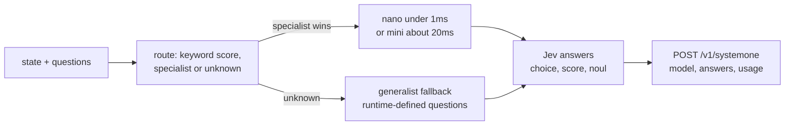

# sabaki

[](https://www.npmjs.com/package/sabaki) [](https://github.com/sabaki-js/sabaki#readme) [](https://github.com/sabaki-js/sabaki/actions)

**Typed decisions on CPU, in milliseconds - Jev-compatible, plugin-routed, open.**

Sabaki routes an unstructured state to the right classifier and returns a **typed answer** (`choice` / `score` / `noul`) with a calibrated confidence - over an HTTP API that speaks the [System One](https://docs.typesafe.ai/concepts/system-one) contract (`POST /v1/systemone`). No GPU, no prompt engineering, no parsing LLM prose.

```ts
import { Sabaki } from "sabaki";
import mail from "@sabaki-js/mail";

const sabaki = new Sabaki().register(mail).setFallback(generalist);
await sabaki.decideAsync({
  state: "Invoice charged twice, need a refund",
  question: "bucket",
  options: ["billing", "spam"],
});
// { decision: "billing", confidence: 0.89, domain: "mail", plugin: "@sabaki-js/mail" }
```

## Why sabaki

| | sabaki nano | sabaki mini | sabaki generalist | OpenDecider | Jev | Laya-td |
|---|---|---|---|---|---|---|
| typed-decisions acc. | 0.61 | 0.69 | 0.848 (mix val v4, phishing 0.955 val / 5-6·9 sonde) | 0.796 | 0.754 | 0.766 |
| CPU latency | **<1 ms** | ~20 ms | ~20-36 ms | GPU (~s) | API only | GPU (25 s/state on CPU) |
| Offline / on-prem | ✅ | ✅ | ✅ | ✅ (GPU) | ❌ | ✅ (GPU) |
| Runtime-defined questions | via fallback | via fallback | ✅ | ❌ | ✅ | ❌ |
| License | MIT | MIT | MIT | - | commercial | Apache-2.0 |

*Benchmark: `LocalLLaMA/typed-decisions`, temporal split (generation batches kept apart, 300 train / 100 test per workflow). Competitor figures are published, not remeasured.* Mail bucket8: nano 0.865 anonymized.*

Sabaki trades a few accuracy points for **1000× lower latency and zero infrastructure**: the whole stack runs on a laptop CPU, offline, with `npm i sabaki`.

## Architecture

Specialists win by routing score; the generalist answers everything else. Only installed plugins ever decide.



**Routing** (`route()`): lowercase, unaccented 4+ letter tokens; loose substring match against `manifest.keywords`; score `hits / √|keywords|`; per-plugin `threshold` (default 0.15, mail 0.03). Below threshold → `unknown`, never a guess.

**Plugins** (`definePlugin` / `nanoClassifier` / `miniClassifier` / `autoClassifier`): the minimal contract is `{ manifest, classify }` - sync or async. Specialists ship fixed questions; the generalist answers **runtime-defined** questions (`instructions` + `criteria`, up to 255 options) with one forward pass per option and argmax.

**Modes**: `nano` (TF-IDF + LogReg, zero deps, <1 ms) → `mini` (MiniLM ONNX int8, 22 MB, SHA256-verified auto-download, ~20 ms) → generalist fallback. `decide()` stays sync (nano); `decideAsync()` unlocks ONNX.

## Jev-compatible serving

```sh
npm i sabaki   # specialists, minis + onnxruntime arrive as optional deps
# nano-only (no ONNX): npm i sabaki --omit=optional
node --input-type=module -e \
  "await (await import('sabaki')).ensureGeneralist()"  # one-time ~90 MB, SHA-verified
SABAKI_GENERALIST_DIR=~/.cache/sabaki/v0.6.0/generalist \
  node node_modules/sabaki/examples/serve.mjs 8000
# add "mode": "auto|nano|mini" per request to force inference (default auto)
```

```sh
curl -X POST localhost:8000/v1/systemone -H 'content-type: application/json' -d '{
  "model": "sabaki-generalist-v1",
  "state": "My invoice charged twice this month",
  "questions": {
    "department": {"type": "choice", "instructions": "Route this message.",
      "criteria": {"billing": "Payments, invoices", "technical": "Bugs, outages"}},
    "urgent": {"type": "noul", "instructions": "Needs a reply today?"}
  }
}'
```

Response shapes follow the System One contract: `choice` → `{choice, probabilities, confidence}`, `score` → `{score, legend, probabilities, confidence}`, `noul` → `{noul}`. The `model` field names the actual responder (`@sabaki-js/mail@1.0.0+mini`, `sabaki-generalist-v1`, or `sabaki-routed(...)` when mixed). Invalid schemas → `422`.

## Production notes

- **Throughput** (i5 CPU): nano ~18k req/s, mini/generalist ~30-70 req/s. Batch questions per call; cap options at 8.
- **Deterministic**: identical input → identical output (verified 100/100). Calibrate thresholds per question, gate on `confidence`.
- **Limits**: generalist is EN-only (`all-MiniLM-L6-v2`, routage EN) — FR hors distribution (sonde 1/4 FR vs 3/4 EN sur cas similaires). Softmax sur-confiant OOD (faux à 1.00 observé) : pour un usage autonome, passer `abstainAt: 0.6–0.7` (→ `decision: null` sous le seuil, à clarifier au lieu de résoudre).
- **Privacy**: fully offline. The mail plugin trains on anonymized corpora (0 PII, audited public release).
- **Install**: `npm i sabaki` (+ optional `@sabaki-js/*` specialists, auto-detected). Serve with pm2 + your reverse proxy; add auth before exposing.

## Plugins

| package | domain | mode |
|---|---|---|
| `@sabaki-js/customer-service` | customer_service | nano + mini |
| `@sabaki-js/invoice-processing` | invoice_processing | nano + mini |
| `@sabaki-js/security-incidents` | security_incidents | nano + mini |
| `@sabaki-js/agent-trace-observability` | agent_trace_observability | nano + mini |
| `@sabaki-js/mail` | mail (8 buckets) | nano + mini |
| `@sabaki-js/doom` | doom (game commands) | nano + mini |
| `@sabaki-js/generalist` | open questions | cross-encoder |

Or start from [`@sabaki-js/plugin-template`](https://github.com/sabaki-js/plugin-template) - see the [GUIDE](https://github.com/sabaki-js/sabaki/blob/main/GUIDE.md).

## License

MIT
